# Portfolio · Nguyen Thi Hong Nga

> **About the data.** The two employer dashboards (projects 1 and 2) are built on **synthetic data** that I generated with a seeded script, because the real data is confidential. Their charts are illustrative previews, not production screenshots, and their numbers are **not real business results**. Projects 3–5 use practice / report datasets that are not company data.

---

## Projects

### 1 · Glass manufacturing performance (Power BI, synthetic data)
Manufacturing business selling Premium and Luxury glass products in Sydney (AUD). The report answers one management question: *which orders, products, promotions, customers and costs drive sales and profit each month?* It is split into **6 pages by purpose**: Overview (executive summary) · Sales & Products · Promotions · Customers & Location · Profit & Costs · Team, all filtered by month and compared with the previous month.
**Tools:** Power BI, DAX, Power Query · **Model:** star schema, ≈3,100 orders, ≈2,400 customers, 20 suburbs, 5 sales staff.
**What the sample report shows** (synthetic, Nov 2025): sales **A$81.8K** (+24.7% MoM), profit margin **27.9%**, COGS **46%** of expenses, promotions **48%** of sales but a **55.5%** margin vs **67.1%** on full-price orders.
**Design:** one accent color, five fixed expense-group colors, KPI cards with sparklines, profit bridge (waterfall), promotion margin vs full price, new vs returning customers, sales concentration by suburb, auto-written insights.

**All 6 pages** (synthetic data):

**1 · Overview**
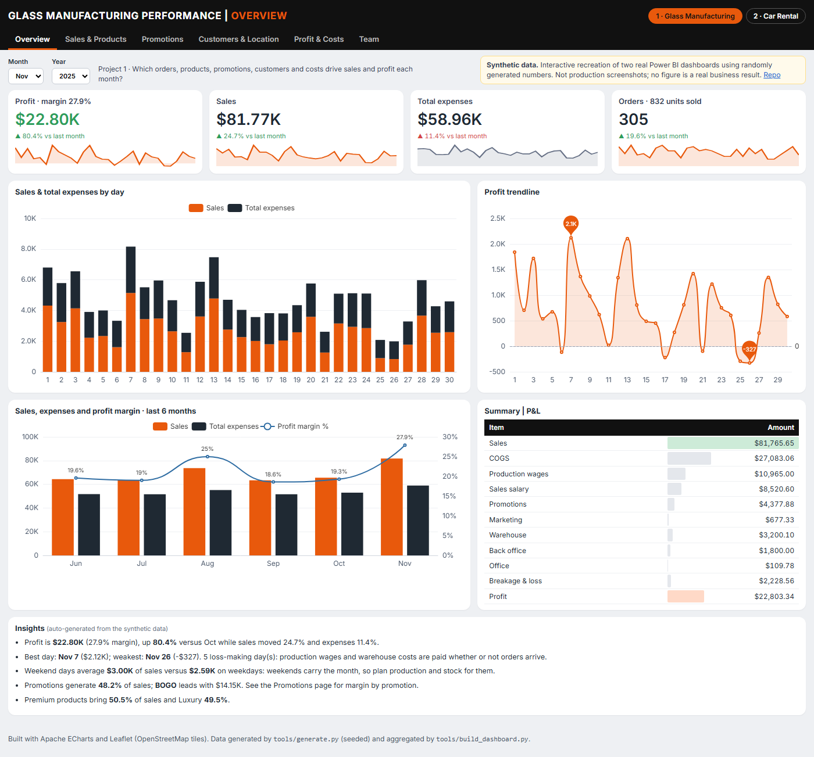

**2 · Sales & Products**
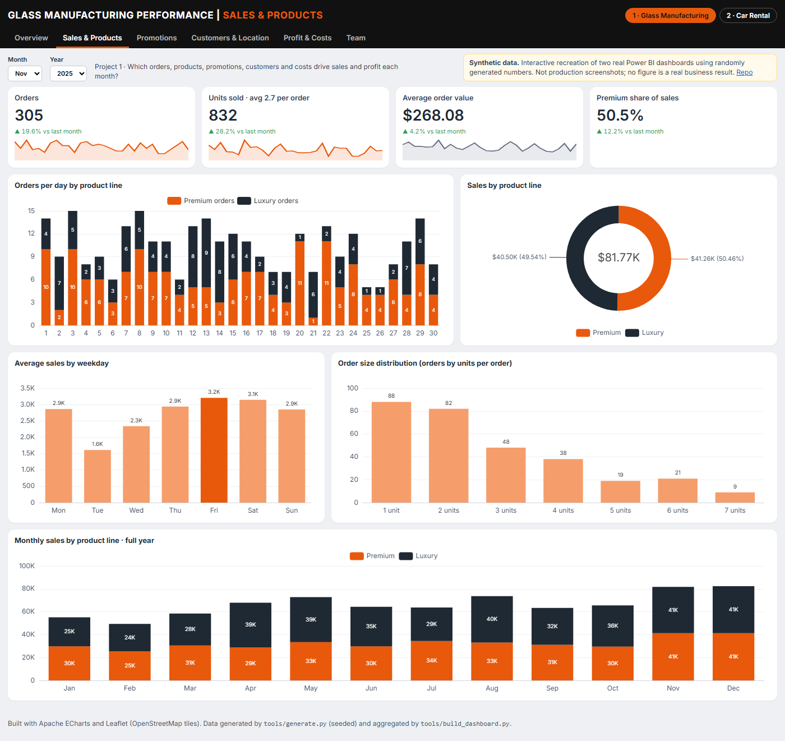

**3 · Promotions**
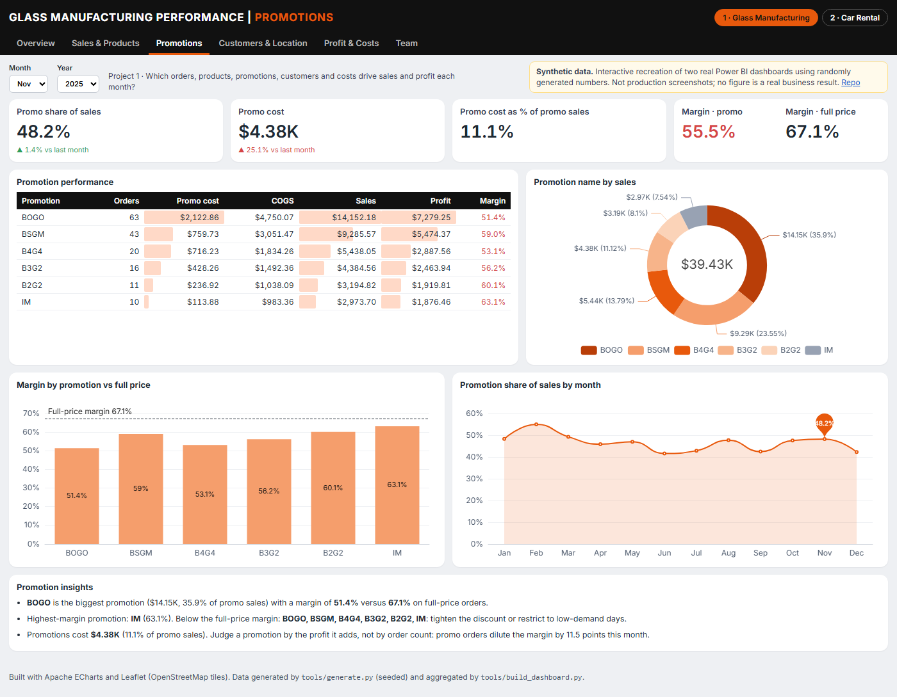

**4 · Customers & Location**
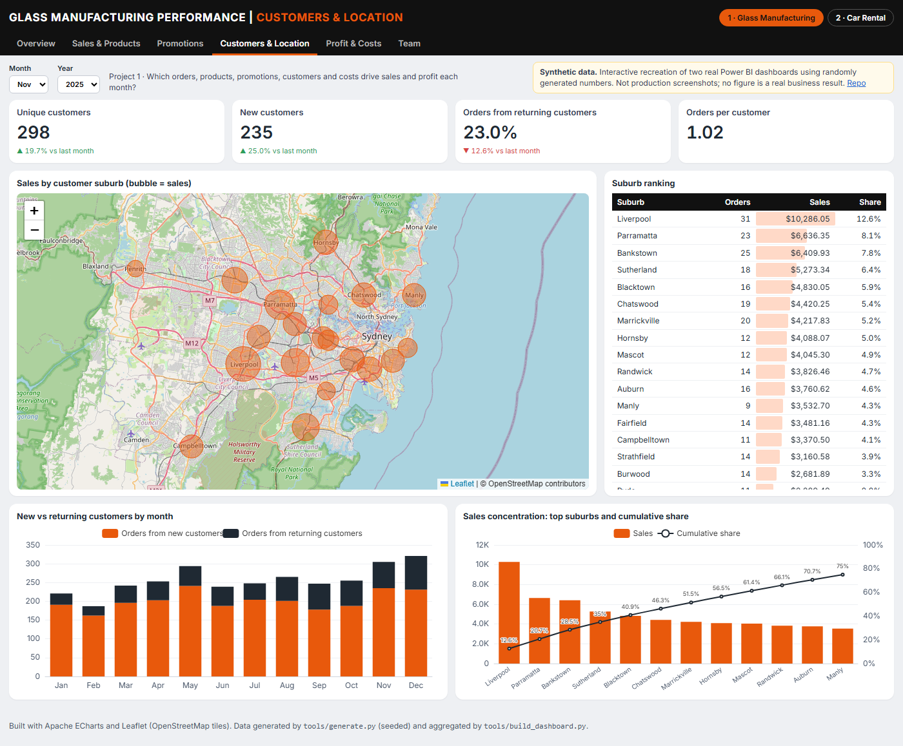

**5 · Profit & Costs**
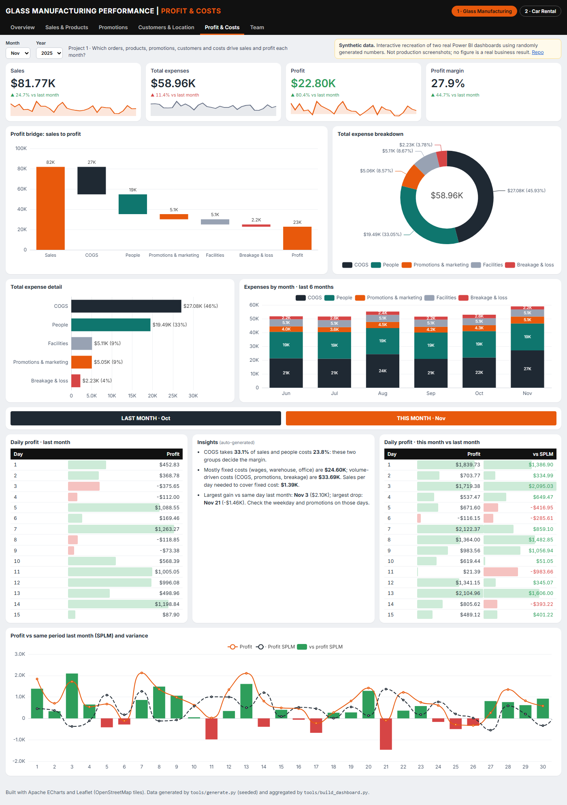

**6 · Team**
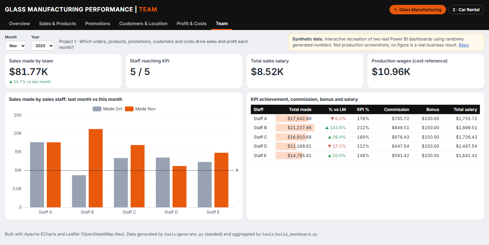

→ [Project folder](projects/glass-manufacturing-performance-powerbi) · [sample report](projects/glass-manufacturing-performance-powerbi/reports/sample-report-2025-11.md) · [data](projects/glass-manufacturing-performance-powerbi/data)

### 2 · Car rental overview (Power BI, synthetic data)
Car rental operation in Sydney (AUD), answering *how much does the fleet earn and cost, and where does the money go?* It is split into **4 pages**: Overview · Expenses (Operation vs Invest) · Material Costs · Fleet & Cars.
**Tools:** Power BI, DAX, Power Query · **Model:** 60 cars (47 rentable), daily rentals, dated expenses by group and category.
**What the sample report shows** (synthetic, Nov 2025): sales **A$27.6K** (-9.7% MoM), profit margin **24.2%**, material costs **75%** of expenses, **33 of 47** rentable cars on rent at month end, **85%** of customers paid.
**Design:** light page with a teal navigation panel, cyan for sales, navy for expenses, amber for highlights, Operation vs Invest split kept on every expense view, expandable expense detail table, status colors with a natural meaning.

**All 4 pages** (synthetic data):

**1 · Overview**
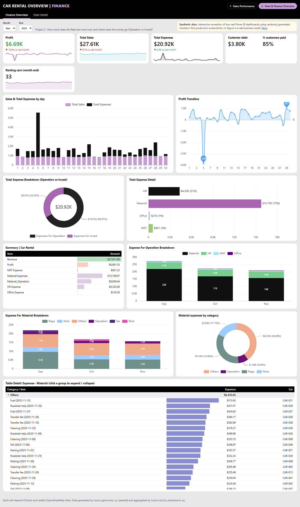

**2 · Expenses**
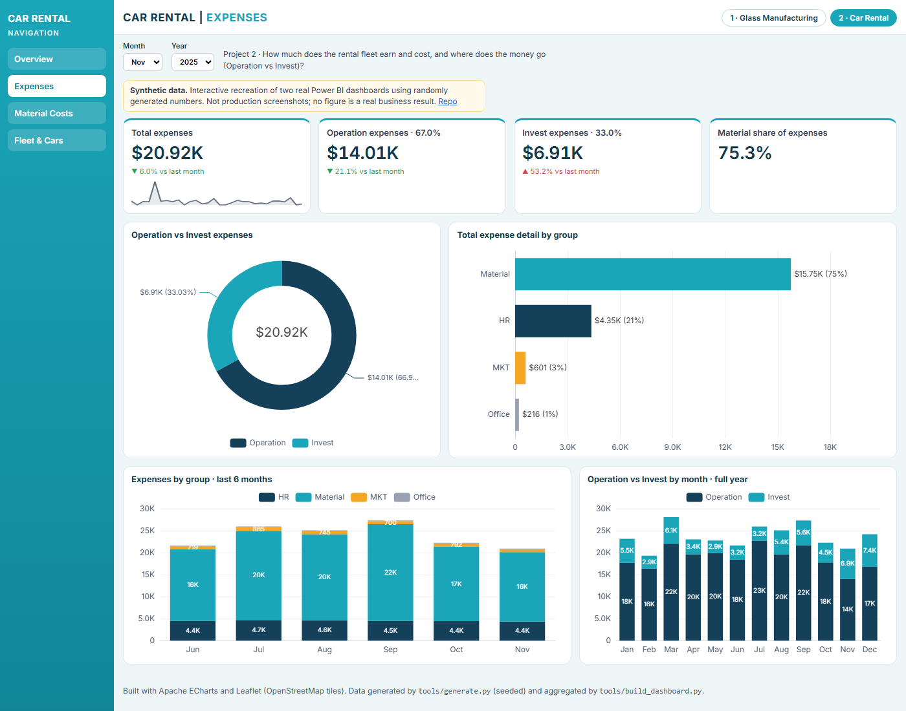

**3 · Material Costs**
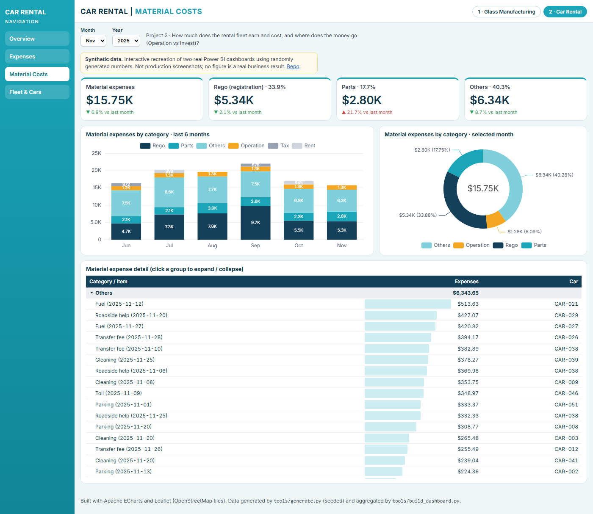

**4 · Fleet & Cars**
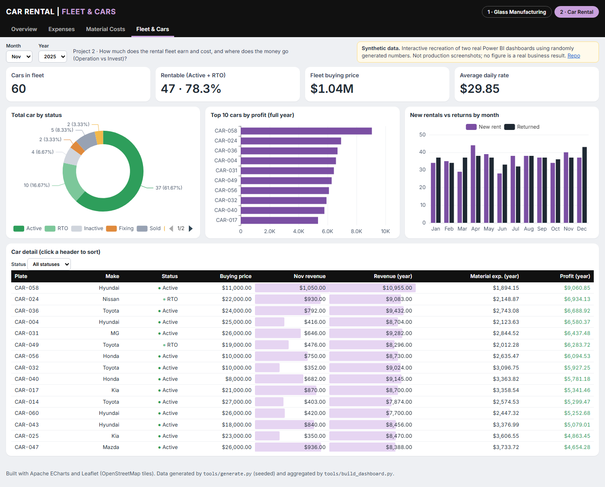

→ [Project folder](projects/car-rental-overview-powerbi) · [sample report](projects/car-rental-overview-powerbi/reports/sample-report-2025-11.md) · [data](projects/car-rental-overview-powerbi/data)

### 3 · LG Social Listening report (Power BI)
Quarterly (Q2) analysis of online discussions about LG and competitors in washing machines: volume, sentiment, content type, audience, and brand comparison.
**Tools:** Power BI · **Data:** LG corporate data, washing-machine category data, demographics (raw data not published).
**Findings:** most sentiment toward LG is **neutral** and customer service gets the most negative feedback; Panasonic has the highest discussion volume, driven by minigames and prizes; LG leads on promotion and usage topics but front-loader washing/rinsing specs raise concerns.

**All 3 pages:**

**1 · Overview**
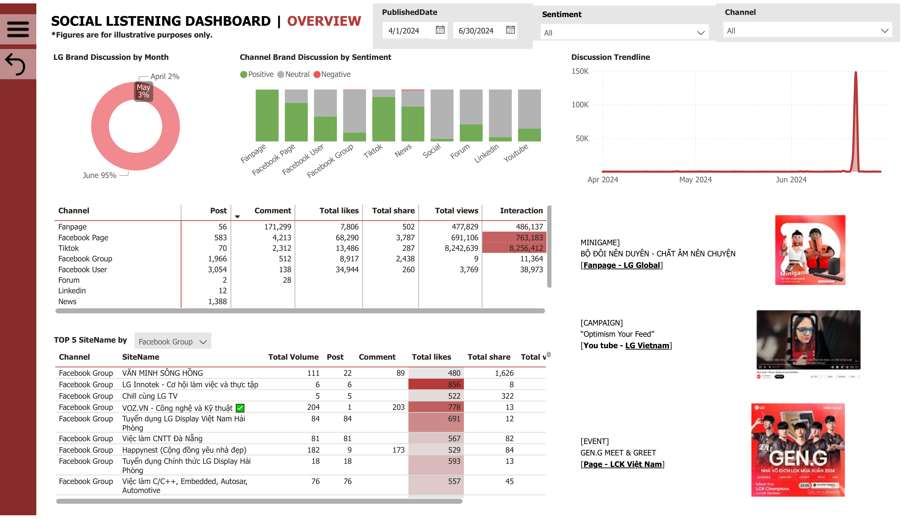

**2 · Detail**
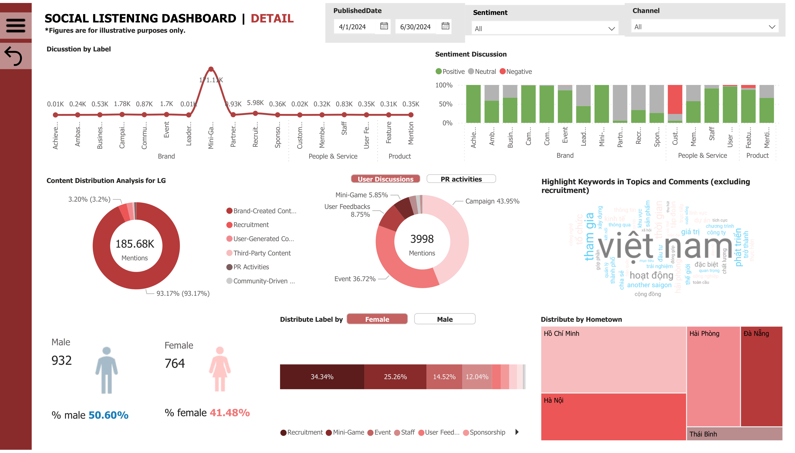

**3 · Competitors**
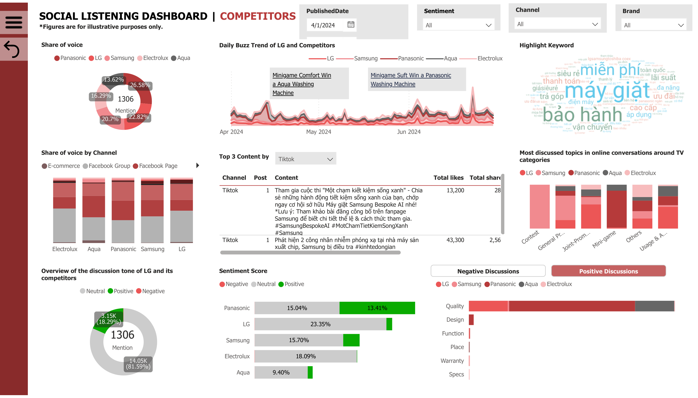

→ [Project folder](projects/lg-social-listening-powerbi) · [PDF report](projects/lg-social-listening-powerbi/report/Report-Social-Listening.pdf) · [data dictionary](projects/lg-social-listening-powerbi/docs/data-dictionary.txt)

### 4 · PayTM customer purchasing analysis (SQL)
Which products sell most on a payment app, do promotions work, and who are the valuable customers across 2018?

| Analysis | What it shows | Techniques |
|---|---|---|
| Top products | Most purchased categories per customer | JOINs, aggregation |
| Promotion effectiveness | Share of successful promo transactions by month; repeat purchases after a first promo | CTEs, `LAG`, `ROW_NUMBER` |
| Cohort retention | Monthly retention of Telco customers over 12 months | window functions, `PIVOT`, temp tables |
| RFM segmentation | Customers grouped into Best, Loyal, Big Spenders, Lost… | `PERCENT_RANK`, `CASE` |

**Findings:** Telco is the most purchased category; repeat purchases after a first promotional transaction exceeded **50%** of measured customers.
→ [Project folder](projects/paytm-customer-analysis-sql) · [SQL](projects/paytm-customer-analysis-sql/sql/paytm_analysis.sql) · [original repo](https://github.com/hongnganguyen/Project-PAYTM)

### 5 · Azuz customer behavior (SQL)
Purchase patterns, the effect of gold membership, and a points-based loyalty program on a small teaching-scale dataset (3 customers, 16 orders).
**Techniques:** CTEs, `RANK()` over partitions, subqueries, `DATEADD`, conditional `LEFT JOIN`.
**Findings:** product 2 earns the most loyalty points; one customer raised spending in the first year of gold membership despite fewer total points.
→ [Project folder](projects/azuz-customer-behavior-sql) · [SQL](projects/azuz-customer-behavior-sql/sql/azuz_analysis.sql) · [original repo](https://github.com/hongnganguyen/Project-Azuz-Web)

---

## How to run

The synthetic datasets, charts and sample reports for projects 1–2 are produced by one seeded script, so results are reproducible.

```powershell
pip install -r requirements.txt
python tools/generate.py
python tools/build_dashboard.py
```

Then open `docs/index.html` through a local server (for example `python -m http.server --directory docs`) to see the interactive dashboards locally.

To rebuild a dashboard, load the CSVs from `projects/<project>/data` into Power BI Desktop and follow the "How to reproduce" section of that project's README. SQL files run on SQL Server (T-SQL).

## Repository layout

```
projects/
  glass-manufacturing-performance-powerbi/  # project 1: data/, images/, reports/
  car-rental-overview-powerbi/              # project 2: data/, images/, reports/
  lg-social-listening-powerbi/              # project 3: images/, report/, docs/
  paytm-customer-analysis-sql/              # project 4: sql/, data/
  azuz-customer-behavior-sql/               # project 5: sql/, data/
docs/                                       # interactive dashboards (index.html, mfg.js, data.js)
tools/generate.py                           # synthetic data + sample reports
tools/build_dashboard.py                    # aggregates the CSVs into docs/data.js
requirements.txt
```

## Tech stack
SQL Server (T-SQL), Power BI (DAX, Power Query, data modeling), Excel / Google Sheets, Python (pandas, NumPy) for synthetic data and sample reports, Apache ECharts + Leaflet (HTML/JS) for the interactive web recreations of the Power BI dashboards.
