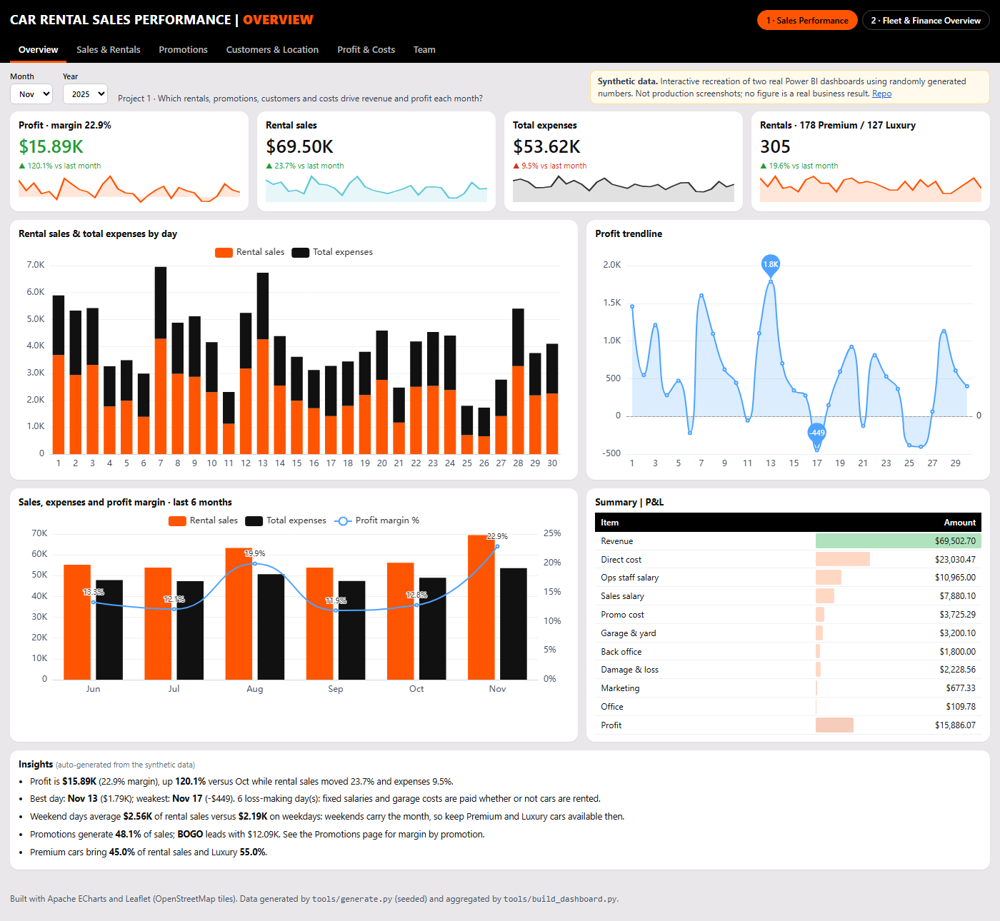

# Data Analytics Portfolio · Nguyen Thi Hong Nga

Data Analyst with an Economics background (UEH, Investment Economics, GPA 3.6/4.0, high distinction). I build automated ETL workflows, interactive Power BI dashboards and KPI / financial reports that support business decisions. This portfolio holds five projects: two Power BI dashboards from my day-to-day work, one social-listening dashboard, and two SQL analyses.

> **About the data.** The two employer dashboards (projects 1 and 2) are built on **synthetic data** that I generated with a seeded script, because the real data is confidential. Their charts are illustrative previews, not production screenshots, and their numbers are **not real business results**. Projects 3–5 use practice / report datasets that are not company data.

| | |
|---|---|
| **Contact** | hongnga230902@gmail.com · 0345 576 131 · Ho Chi Minh City |
| **CV** | [CV_Nguyen_Thi_Hong_Nga.pdf](docs/CV_Nguyen_Thi_Hong_Nga.pdf) |
| **Interactive dashboards** | [hongnganguyen.github.io/Hong-Nga-Portfolio](https://hongnganguyen.github.io/Hong-Nga-Portfolio/) (projects 1 and 2, synthetic data) |
| **Skills** | SQL (T-SQL) · Power BI (DAX, data modeling) · Power Query · Advanced Excel · Google Sheets · basic Python |
| **Source repos** | [Project-PAYTM](https://github.com/hongnganguyen/Project-PAYTM) · [Project-Azuz-Web](https://github.com/hongnganguyen/Project-Azuz-Web) |

[](projects/lg-social-listening-powerbi)

---

## Projects

### 1 · Car rental sales performance (Power BI, synthetic data)
Car rental business in Sydney (AUD). The report answers one management question: *which rentals, promotions, customers and costs drive revenue and profit each month?* It is split into **6 pages by purpose**: Overview (executive summary) · Sales & Rentals · Promotions · Customers & Location · Profit & Costs · Team, all filtered by month and compared with the previous month.
**Tools:** Power BI, DAX, Power Query · **Model:** star schema, ≈3,100 rentals, ≈2,400 customers, 20 suburbs, 5 sales staff.
**What the sample report shows** (synthetic, Nov 2025): rental sales **A$69.5K** (+23.7% MoM), profit margin **22.9%**, direct cost **43%** of expenses, promotions **48%** of sales but a **55.5%** margin vs **67.1%** on full-price rentals.
**Design:** KPI cards with sparklines, profit bridge (waterfall), promotion margin vs full price, new vs returning customers, sales concentration by suburb, last-month vs this-month comparison and auto-written insights.

[](projects/car-rental-sales-performance-powerbi/images/01-overview.png)
[](projects/car-rental-sales-performance-powerbi/images/05-profit-costs.png)

→ [Live dashboard](https://hongnganguyen.github.io/Hong-Nga-Portfolio/) · [Project folder](projects/car-rental-sales-performance-powerbi) · [sample report](projects/car-rental-sales-performance-powerbi/reports/sample-report-2025-11.md) · [data](projects/car-rental-sales-performance-powerbi/data)

### 2 · Car rental fleet & finance overview (Power BI, synthetic data)
The companion dashboard for the same business (Sydney, AUD), answering *how much does the fleet earn and cost, and where does the money go?*: **sales, expense groups (Operation vs Invest), profit, fleet status and customer debt**, plus a fleet-detail page with per-car profitability.
**Tools:** Power BI, DAX, Power Query · **Model:** 60 cars (44 rentable), daily rentals, dated expenses by group and category.
**What the sample report shows** (synthetic, Nov 2025): sales **A$27.4K** (+8.8% MoM), profit margin **26.1%**, material costs **72%** of expenses, **33 of 44** rentable cars on rent at month end, **79%** of customers paid.
**Design:** Operation vs Invest split, expandable expense detail table, stacked month-by-month breakdowns.

[](projects/car-rental-overview-powerbi/images/01-overview.png)

→ [Live dashboard](https://hongnganguyen.github.io/Hong-Nga-Portfolio/#c-over) · [Project folder](projects/car-rental-overview-powerbi) · [sample report](projects/car-rental-overview-powerbi/reports/sample-report-2025-11.md) · [data](projects/car-rental-overview-powerbi/data)

### 3 · LG Social Listening report (Power BI)
Quarterly (Q2) analysis of online discussions about LG and competitors in washing machines: volume, sentiment, content type, audience, and brand comparison.
**Tools:** Power BI · **Data:** LG corporate data, washing-machine category data, demographics (raw data not published).
**Findings:** most sentiment toward LG is **neutral** and customer service gets the most negative feedback; Panasonic has the highest discussion volume, driven by minigames and prizes; LG leads on promotion and usage topics but front-loader washing/rinsing specs raise concerns.

[](projects/lg-social-listening-powerbi/images/dashboard-page-2.png)
[](projects/lg-social-listening-powerbi/images/dashboard-page-3.png)

→ [Project folder](projects/lg-social-listening-powerbi) · [PDF report](projects/lg-social-listening-powerbi/report/Report-Social-Listening.pdf) · [data dictionary](projects/lg-social-listening-powerbi/docs/data-dictionary.txt)

### 4 · PayTM customer purchasing analysis (SQL)
Which products sell most on a payment app, do promotions work, and who are the valuable customers across 2018?

| Analysis | What it shows | Techniques |
|---|---|---|
| Top products | Most purchased categories per customer | JOINs, aggregation |
| Promotion effectiveness | Share of successful promo transactions by month; repeat purchases after a first promo | CTEs, `LAG`, `ROW_NUMBER` |
| Cohort retention | Monthly retention of Telco customers over 12 months | window functions, `PIVOT`, temp tables |
| RFM segmentation | Customers grouped into Best, Loyal, Big Spenders, Lost… | `PERCENT_RANK`, `CASE` |

**Findings:** Telco is the most purchased category; repeat purchases after a first promotional transaction exceeded **50%** of measured customers.
→ [Project folder](projects/paytm-customer-analysis-sql) · [SQL](projects/paytm-customer-analysis-sql/sql/paytm_analysis.sql)

### 5 · Azuz customer behavior (SQL)
Purchase patterns, the effect of gold membership, and a points-based loyalty program on a small teaching-scale dataset (3 customers, 16 orders).
**Techniques:** CTEs, `RANK()` over partitions, subqueries, `DATEADD`, conditional `LEFT JOIN`.
**Findings:** product 2 earns the most loyalty points; one customer raised spending in the first year of gold membership despite fewer total points.
→ [Project folder](projects/azuz-customer-behavior-sql) · [SQL](projects/azuz-customer-behavior-sql/sql/azuz_analysis.sql)

---

## Experience

**Data Analysis · HeraPrimes** (Apr 2025 – now) — automated Power BI reports on revenue, cost, profit and Sales & Marketing KPIs; ETL workflows in Power Query and Excel; AOP budget tracking and variance analysis (automotive service and manufacturing); cash-flow forecasts.

**Junior Operation Analyst, Research / Data Processing · Kompa Technology** (Dec 2023 – Mar 2025) — Kibana quality checks removing **10–25%** inaccurate data; automation that raised productivity by **50–80%**; real-time dashboards.

**Teaching Assistant · VyLe Training** (May 2024 – now) — supported 20+ Excel / Power BI classes and analyzed learner feedback.

## Education & awards
University of Economics HCMC (UEH), B.A. Investment Economics, 2020–2024, GPA 3.6/4.0 · 3rd Prize E-research Award 2022 · 2nd Prize UEH Young Researcher 2022 · 3 GPA scholarships · IC3 · TOEIC 715
Courses: SQL & Python for Data Analysis (MazHocData), Excel for Analysis and Power BI Essential (Vy Le Training), Finance for Leaders (PACE Training)

---

## How to run

The synthetic datasets, charts and sample reports for projects 1–2 are produced by one seeded script, so results are reproducible.

```powershell
pip install -r requirements.txt
python tools/generate.py
python tools/build_dashboard.py
```

Then open `docs/index.html` through a local server (for example `python -m http.server --directory docs`) to see the interactive dashboards; the same folder is published with GitHub Pages.

To rebuild a dashboard, load the CSVs from `projects/<project>/data` into Power BI Desktop and follow the "How to reproduce" section of that project's README. SQL files run on SQL Server (T-SQL).

## Repository layout

```
projects/
  car-rental-sales-performance-powerbi/  # project 1: data/, images/, reports/
  car-rental-overview-powerbi/           # project 2: data/, images/, reports/
  lg-social-listening-powerbi/        # project 3: images/, report/, docs/
  paytm-customer-analysis-sql/        # project 4: sql/, data/
  azuz-customer-behavior-sql/         # project 5: sql/, data/
docs/                                 # GitHub Pages: index.html, sales.js, data.js, CV PDF
tools/generate.py                     # synthetic data + sample reports
tools/build_dashboard.py              # aggregates the CSVs into docs/data.js
requirements.txt
```

## Tech stack
SQL Server (T-SQL), Power BI (DAX, Power Query, data modeling), Excel / Google Sheets, Python (pandas, NumPy) for synthetic data and sample reports, Apache ECharts + Leaflet (HTML/JS) for the interactive web recreations of the Power BI dashboards.
