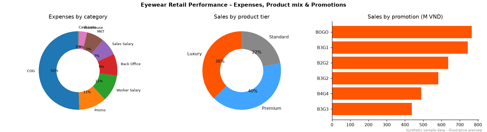
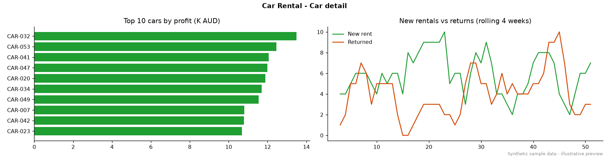

# Data Analytics Portfolio · Nguyen Thi Hong Nga

Data Analyst with an Economics background (UEH, Investment Economics, GPA 3.6/4.0, high distinction). I build automated ETL workflows, interactive Power BI dashboards and KPI / financial reports that support business decisions. This portfolio holds five projects: two Power BI dashboards from my day-to-day work, one social-listening dashboard, and two SQL analyses.

> **About the data.** The two employer dashboards (projects 1 and 2) are built on **synthetic data** that I generated with a seeded script, because the real data is confidential. Their charts are illustrative previews, not production screenshots, and their numbers are **not real business results**. Projects 3–5 use practice / report datasets that are not company data.

| | |
|---|---|
| **Contact** | hongnga230902@gmail.com · 0345 576 131 · Ho Chi Minh City |
| **Skills** | SQL (T-SQL) · Power BI (DAX, data modeling) · Power Query · Advanced Excel · Google Sheets · basic Python |
| **Source repos** | [Project-PAYTM](https://github.com/hongnganguyen/Project-PAYTM) · [Project-Azuz-Web](https://github.com/hongnganguyen/Project-Azuz-Web) |

[](projects/lg-social-listening-powerbi)

---

## Projects

### 1 · Automotive glass service performance (Power BI, synthetic data)
Multi-branch business selling and installing car glass. One dashboard tracks daily and monthly **sales, every expense line, profit, promotions and staff KPIs**, with month-over-month comparison. 3 pages: Overview, Worker, Location (map).
**Tools:** Power BI, DAX, Power Query · **Model:** star schema, 4 branches, 5 staff, ≈9,000 orders.
**What the sample report shows** (synthetic): sales **10,225 M VND**, profit margin **16.8%**, COG the largest cost at **42%** of sales, strong year-end seasonality (peak Dec, low Feb).

[](projects/retail-store-performance-powerbi/images/01-overview.png)
[](projects/retail-store-performance-powerbi/images/02-expenses-promotions.png)

→ [Project folder](projects/retail-store-performance-powerbi) · [sample report](projects/retail-store-performance-powerbi/reports/sample-annual-report-2025.md) · [data](projects/retail-store-performance-powerbi/data)

### 2 · Car rental overview (Power BI, synthetic data)
Dashboard for a car-rental operation: **revenue, expense groups (Invest vs Operation), profit, fleet status and customer debt**, plus a detail page with per-car profitability.
**Tools:** Power BI, DAX, Power Query · **Model:** 60 cars, 52 weeks, material / HR / office expenses.
**What the sample report shows** (synthetic): revenue **484,970 AUD**, profit margin **24.3%**, **20 of 60** cars not yet covering their material costs, 10 customers with outstanding balances.

[](projects/car-rental-overview-powerbi/images/01-overview.png)
[](projects/car-rental-overview-powerbi/images/03-car-detail.png)

→ [Project folder](projects/car-rental-overview-powerbi) · [sample report](projects/car-rental-overview-powerbi/reports/sample-annual-report-2025.md) · [data](projects/car-rental-overview-powerbi/data)

### 3 · LG Social Listening report (Power BI)
Quarterly (Q2) analysis of online discussions about LG and competitors in washing machines: volume, sentiment, content type, audience, and brand comparison.
**Tools:** Power BI · **Data:** LG corporate data, washing-machine category data, demographics (raw data not published).
**Findings:** most sentiment toward LG is **neutral** and customer service gets the most negative feedback; Panasonic has the highest discussion volume, driven by minigames and prizes; LG leads on promotion and usage topics but front-loader washing/rinsing specs raise concerns.

[](projects/lg-social-listening-powerbi/images/dashboard-page-2.png)
[](projects/lg-social-listening-powerbi/images/dashboard-page-3.png)

→ [Project folder](projects/lg-social-listening-powerbi) · [PDF report](projects/lg-social-listening-powerbi/report/Report-Social-Listening.pdf) · [data dictionary](projects/lg-social-listening-powerbi/docs/data-dictionary.txt)

### 4 · PayTM customer purchasing analysis (SQL)
Which products sell most on a payment app, do promotions work, and who are the valuable customers across 2018?

| Analysis | What it shows | Techniques |
|---|---|---|
| Top products | Most purchased categories per customer | JOINs, aggregation |
| Promotion effectiveness | Share of successful promo transactions by month; repeat purchases after a first promo | CTEs, `LAG`, `ROW_NUMBER` |
| Cohort retention | Monthly retention of Telco customers over 12 months | window functions, `PIVOT`, temp tables |
| RFM segmentation | Customers grouped into Best, Loyal, Big Spenders, Lost… | `PERCENT_RANK`, `CASE` |

**Findings:** Telco is the most purchased category; repeat purchases after a first promotional transaction exceeded **50%** of measured customers.
→ [Project folder](projects/paytm-customer-analysis-sql) · [SQL](projects/paytm-customer-analysis-sql/sql/paytm_analysis.sql)

### 5 · Azuz customer behavior (SQL)
Purchase patterns, the effect of gold membership, and a points-based loyalty program on a small teaching-scale dataset (3 customers, 16 orders).
**Techniques:** CTEs, `RANK()` over partitions, subqueries, `DATEADD`, conditional `LEFT JOIN`.
**Findings:** product 2 earns the most loyalty points; one customer raised spending in the first year of gold membership despite fewer total points.
→ [Project folder](projects/azuz-customer-behavior-sql) · [SQL](projects/azuz-customer-behavior-sql/sql/azuz_analysis.sql)

---

## Experience

**Data Analysis · HeraPrimes** (Apr 2025 – now) — automated Power BI reports on revenue, cost, profit and Sales & Marketing KPIs; ETL workflows in Power Query and Excel; AOP budget tracking and variance analysis (automotive service and manufacturing); cash-flow forecasts.

**Junior Operation Analyst, Research / Data Processing · Kompa Technology** (Dec 2023 – Mar 2025) — Kibana quality checks removing **10–25%** inaccurate data; automation that raised productivity by **50–80%**; real-time dashboards.

**Teaching Assistant · VyLe Training** (May 2024 – now) — supported 20+ Excel / Power BI classes and analyzed learner feedback.

## Education & awards
University of Economics HCMC (UEH), B.A. Investment Economics, 2020–2024, GPA 3.6/4.0 · 3rd Prize E-research Award 2022 · 2nd Prize UEH Young Researcher 2022 · 3 GPA scholarships · IC3 · TOEIC 715
Courses: SQL & Python for Data Analysis (MazHocData), Excel for Analysis and Power BI Essential (Vy Le Training), Finance for Leaders (PACE Training)

---

## How to run

The synthetic datasets, charts and sample reports for projects 1–2 are produced by one seeded script, so results are reproducible.

```powershell
pip install -r requirements.txt
python tools/generate.py
```

To rebuild a dashboard, load the CSVs from `projects/<project>/data` into Power BI Desktop and follow the "How to reproduce" section of that project's README. SQL files run on SQL Server (T-SQL).

## Repository layout

```
projects/
  retail-store-performance-powerbi/   # project 1: data/, images/, reports/
  car-rental-overview-powerbi/        # project 2: data/, images/, reports/
  lg-social-listening-powerbi/        # project 3: images/, report/, docs/
  paytm-customer-analysis-sql/        # project 4: sql/, data/
  azuz-customer-behavior-sql/         # project 5: sql/, data/
tools/generate.py                     # synthetic data + charts + sample reports
requirements.txt
```

## Tech stack
SQL Server (T-SQL), Power BI (DAX, Power Query, data modeling), Excel / Google Sheets, Python (pandas, NumPy, matplotlib) for synthetic data and chart previews.
