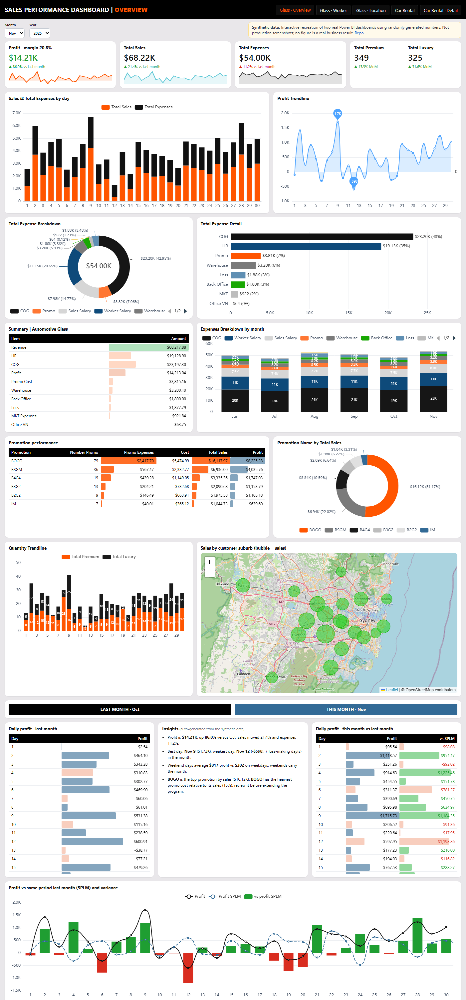
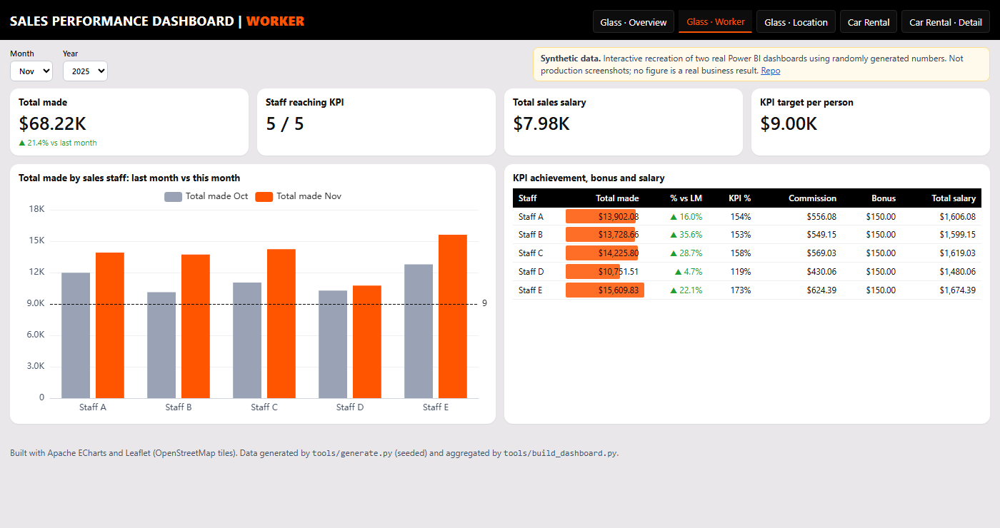
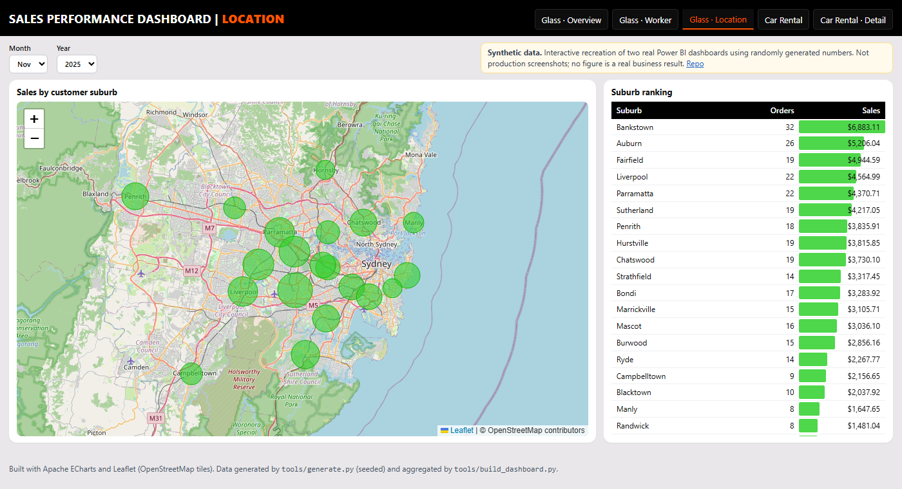

# Automotive Glass Service Performance Dashboard (Kiếng) — Power BI

**Tools:** Power BI (data modeling, DAX, Power Query), Excel · **Currency:** AUD · **Area:** Sydney, Australia
**Live interactive recreation:** [hongnganguyen.github.io/Hong-Nga-Portfolio](https://hongnganguyen.github.io/Hong-Nga-Portfolio/) (pages *Glass · Overview / Worker / Location*)

> ⚠️ **About the data.** The original dashboard was built for a real employer, so its data (customers, staff, suburbs, finances) is confidential and is not published. Everything in this folder is **synthetic**: randomly generated (fixed seed) with the same table structure, the same kind of metrics and the same page layout as the real report. The images are screenshots of a web recreation of the dashboard built from that synthetic data, **not** screenshots of the production report, and no number is a real business result.

## Business problem
A car glass sales and installation business needed one place to monitor daily and monthly performance: sales, every expense line, profit, promotion effectiveness, product mix (Premium vs Luxury) and the sales team's KPIs, always compared with the previous month.

## Dashboard structure (3 pages)
| Page | What it shows |
|---|---|
| **Overview** | KPI cards with sparklines and month-over-month (MoM) change: Total Sales, Profit, Total Expenses, Total Premium / Luxury quantity · daily **Profit trendline** and **Sales vs Expenses** columns · **Quantity trendline** (Premium / Luxury) · bubble **map** of sales by customer suburb · **Expenses breakdown** (COG, salaries, promo, warehouse, back office, loss, MKT) over the last months · **Promotion** donut and table (number of promos, promo expense, cost, sales, profit per promotion: BOGO, BSGM, B4G4, B3G2, B2G2, IM) · **Summary** P&L table · **Last month vs This month** daily profit tables with variance vs same period last month (SPLM) and written insights · profit vs SPLM combo chart |
| **Worker** | Per-staff total made vs previous month, % change, KPI achievement, commission, bonus and total salary |
| **Location** | Map and ranking of sales by customer suburb |

Design choices: same layout standard as the Car Rental dashboard (black header band with page tabs, grey page background, sparkline KPI cards, expense donut + detail bars, summary table), orange / black accent palette, sparkline KPI cards, data bars inside tables, positive/negative variance colors, one insight box that turns the numbers into actions.

## Data model (star schema)
`orders` (fact: date, suburb, product line, quantity, amount, promotion, promo expense, COGS, sales staff) · `expenses` (daily fact by category) · `staff_kpi` · `promotions` · `suburbs` · `calendar`
CSV files in [`data/`](data) (≈3,200 synthetic orders in 2025, 20 suburbs, 5 staff).

Measures in the model (names): Total Sales, Sales Same Day Last Month, Total Expenses (+SPLM), COG / MKT / Back-office / Warehouse / Promo expenses, Cash Loss, Profit (+SPLM, vs profit SPLM), % Profit Margin, Total Premium / Luxury (+SPLM), Total Made, KPIs, Bonus, Total Salary.

## Preview (synthetic data)

## Sample report
[`reports/sample-report-2025-11.md`](reports/sample-report-2025-11.md) — an example of the monthly report that sits on top of the dashboard (KPIs vs previous month, expense structure, promotion performance, highlights, recommended actions), computed from the synthetic data.

## How to reproduce
Run `python tools/generate.py` and `python tools/build_dashboard.py` from the repo root. To rebuild it in Power BI Desktop, load the CSVs (Get Data → Text/CSV), relate `orders[date]` and `expenses[date]` to `calendar[date]`, `orders[suburb]` to `suburbs`, `orders[sales_staff]` to `staff_kpi[staff]`, then build the measures above.
