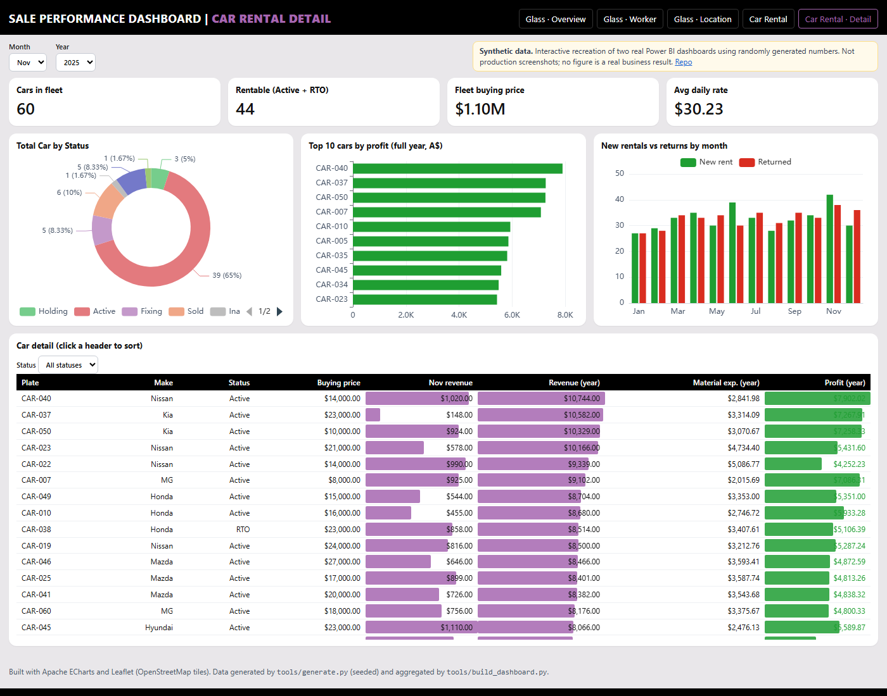

# Car Rental Fleet & Finance Overview Dashboard — Power BI

**Tools:** Power BI (data modeling, DAX, Power Query), Excel · **Currency:** AUD · **Area:** Sydney, Australia
**Live interactive recreation:** [hongnganguyen.github.io/Hong-Nga-Portfolio](https://hongnganguyen.github.io/Hong-Nga-Portfolio/#c-over) (project **2 · Fleet & Finance Overview**: pages *Finance Overview* and *Fleet Detail*). It is a different business from the [Sales Performance dashboard](../car-rental-sales-performance-powerbi) (project 1).

> ⚠️ **About the data.** The original dashboard was built for a real employer, so its data (customers, car plates, staff, bank transactions) is confidential and is not published. Everything in this folder is **synthetic**: randomly generated (fixed seed) with the same table structure, the same kind of metrics and the same page layout as the real report. The images are screenshots of a web recreation of the dashboard built from that synthetic data, **not** screenshots of the production report, and no number is a real business result.

## Business problem
A car-rental operation needed to track sales, every expense group, profit, fleet status and customer debt in one place, and to separate **Operation** expenses from **Invest** expenses so that running costs are not mixed with fleet investment.

## Dashboard structure (2 pages)
| Page | What it shows |
|---|---|
| **Car Rental (overview)** | KPI cards with sparklines and MoM change: Profit, Total Sales, Total Expenses; customer debt and % customers paid; cars on rent · **Sales & Total Expenses** by day · **Profit trendline** · **Expense breakdown** (Operation vs Invest) · **Expense detail** (HR, Material, Office, MKT with % of total) · **Summary** table · **Expense for Operation** and **Expense for Material** breakdowns over recent months (Rego, Parts, Others, Operation, Tax, Rent) · material category donut · expandable **table detail** of every material expense |
| **Car Rental Detail** | Fleet by status (Active, RTO, Holding, Fixing, Sold, Lost, Inactive) · top cars by profit · new rentals vs returns by month · sortable per-car table with revenue, material expenses and profit |

Design choices: Month/Year slicers, purple / black palette, sparkline KPI cards, drill-down groups in the detail table, red/green variance colors.

## Data model
`car_info` · `revenue_daily` · `rental_events` · `expenses` (group: Material / HR / MKT / Office; category; type Operation or Invest; car plate) · `customer_debt` · `calendar`
CSV files in [`data/`](data) (60 synthetic cars, 44 rentable, daily rentals through 2025).

Measures in the model (names): Rent Total Sales / Expenses / Profit, Rent Material Exp (for Operation / for Invest), Rent HR Expenses, Rent MKT Expenses, Rent Total Orders, % format vs Sales / Expenses / Profit, Total customer debt and % customers paid, Car_Detail Revenue / Expenses / Profit.

## Preview (synthetic data)

## Sample report
[`reports/sample-report-2025-11.md`](reports/sample-report-2025-11.md) — example monthly report (KPIs vs previous month, expense structure, highlights, recommended actions) computed from the synthetic data.

## How to reproduce
Run `python tools/generate.py` and `python tools/build_dashboard.py` from the repo root. To rebuild it in Power BI Desktop, load the CSVs, relate `plate` across `car_info`, `revenue_daily` and `expenses`, link dates to `calendar`, then build the measures above.
