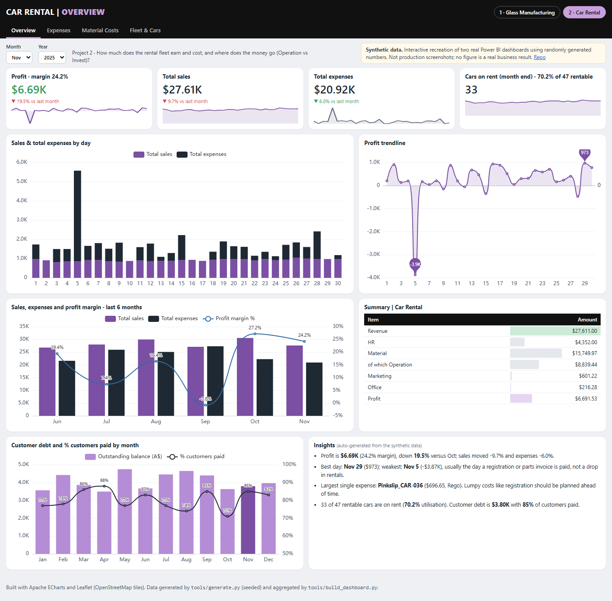
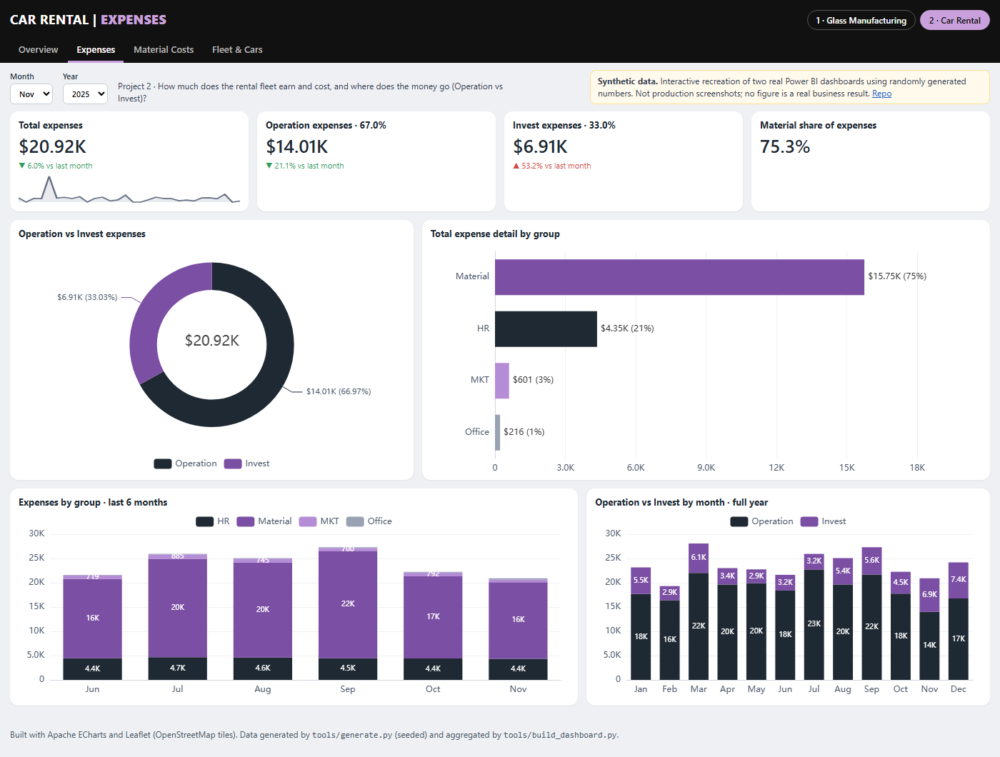
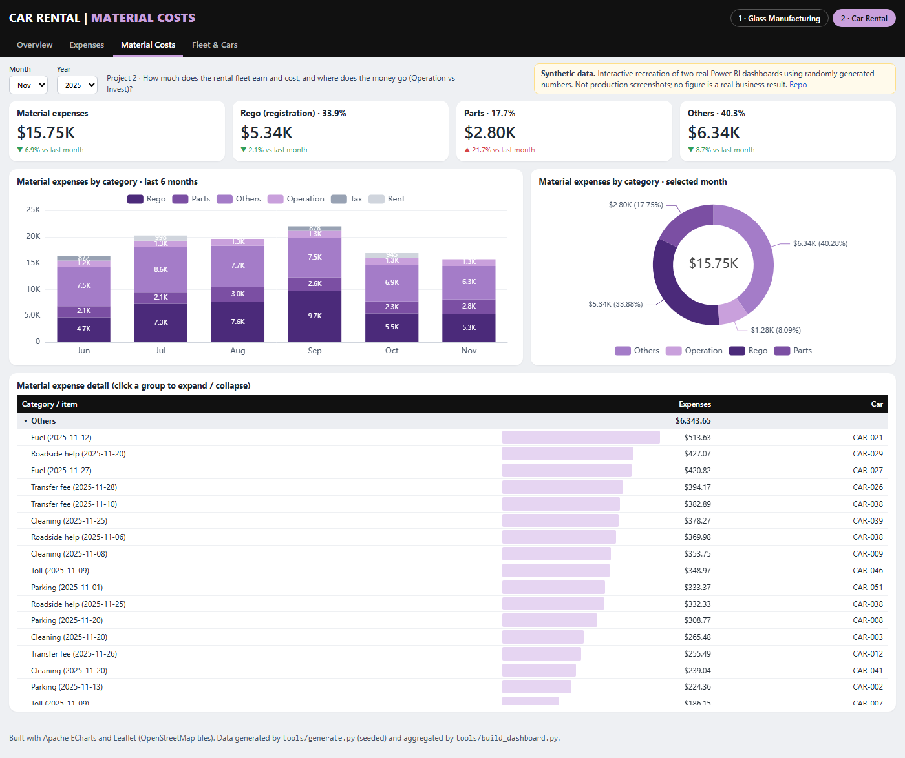
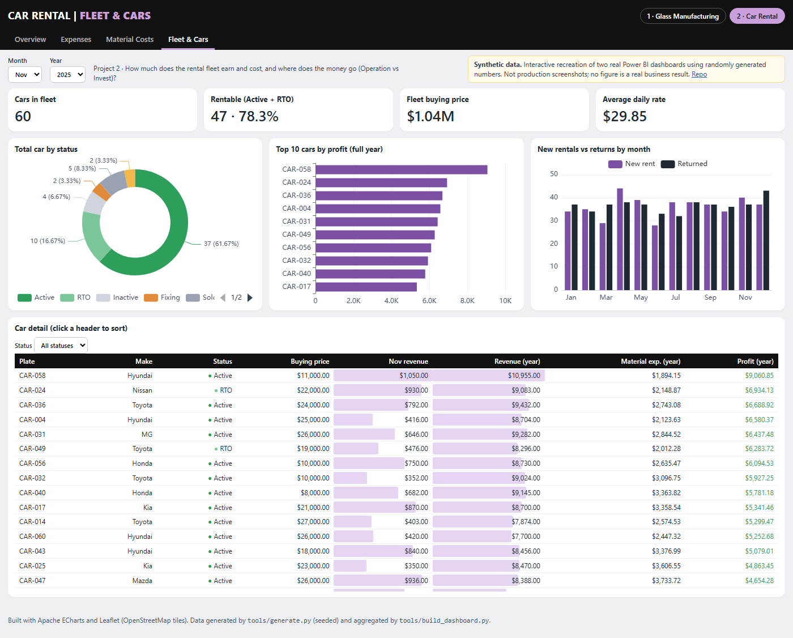

# Car Rental Overview Dashboard — Power BI

**Industry:** car rental · **Tools:** Power BI (data modeling, DAX, Power Query), Excel · **Currency:** AUD · **Area:** Sydney, Australia
**Live interactive recreation:** [hongnganguyen.github.io/Hong-Nga-Portfolio](https://hongnganguyen.github.io/Hong-Nga-Portfolio/#c-over) (project **2 · Car Rental**, 4 pages)

> ⚠️ **About the data.** The original dashboard was built for a real employer, so its data (customers, car plates, staff, bank transactions) is confidential and is not published. Everything in this folder is **synthetic**: randomly generated (fixed seed) with the same kind of tables and metrics as the real report. The images are screenshots of a web recreation of the dashboard built from that synthetic data, **not** screenshots of the production report, and no number is a real business result.

## Business question
> *How much does the rental fleet earn and cost, and where does the money go?* In particular, running costs (**Operation**) must not be mixed with fleet investment (**Invest**).

The report is split into four pages so that each page answers one question:

| Page | Question | What it shows |
|---|---|---|
| **1 · Overview** | How is the month going? | KPI cards with sparklines and MoM change (profit and margin, sales, expenses, cars on rent and utilisation) · sales vs expenses by day · profit trendline · last 6 months with margin · summary table · customer debt and % customers paid by month · auto-written insights |
| **2 · Expenses** | Where does the money go? | Total, Operation and Invest expenses and the material share · Operation vs Invest donut · detail by group (HR, Material, Marketing, Office) · expenses by group over 6 months · Operation vs Invest by month |
| **3 · Material Costs** | What drives the material cost? | Material, Rego, Parts and Others KPIs · material categories (Rego, Parts, Others, Operation, Tax, Rent) over 6 months and for the selected month · expandable table of every material expense with the car it belongs to |
| **4 · Fleet & Cars** | Which cars earn their keep? | Fleet by status (Active, RTO, Holding, Fixing, Sold, Lost, Inactive) · top cars by profit · new rentals vs returns by month · sortable per-car table with revenue, material expenses and profit |

## Design system (why the colors are limited)
- **One accent color** (purple) for sales and the key measure; expenses are **ink** so income and cost are always distinguishable at a glance.
- **Green and red mean good and bad only**, plus car status where the meaning is natural (green = earning, amber = temporarily not earning, grey = gone, red = lost).
- Expense groups, Operation vs Invest and material categories use **fixed colors** (purple tints for material categories), the same on every page.
- Layout: overview first, then one drill-down page per question; the same Month slicer and previous-month comparison on every page; KPI cards that show value, trend and change together; expandable detail table instead of an endless list.

## Data model
`car_info` · `revenue_daily` · `rental_events` · `expenses` (group: Material / HR / MKT / Office; category; type Operation or Invest; car plate) · `customer_debt` · `calendar`
CSV files in [`data/`](data) (60 synthetic cars, 47 rentable, daily rentals through 2025).

Measures in the model (names): Rent Total Sales / Expenses / Profit, Rent Material Exp (for Operation / for Invest), Rent HR Expenses, Rent MKT Expenses, Rent Total Orders, % format vs Sales / Expenses / Profit, Total customer debt and % customers paid, Car_Detail Revenue / Expenses / Profit.

## Preview (synthetic data)

## Sample report
[`reports/sample-report-2025-11.md`](reports/sample-report-2025-11.md): example monthly report (KPIs vs previous month, expense structure, highlights, recommended actions) computed from the synthetic data.

## How to reproduce
Run `python tools/generate.py` and `python tools/build_dashboard.py` from the repo root. To rebuild it in Power BI Desktop, load the CSVs, relate `plate` across `car_info`, `revenue_daily` and `expenses`, link dates to `calendar`, then build the measures above and one report page per row of the table.
