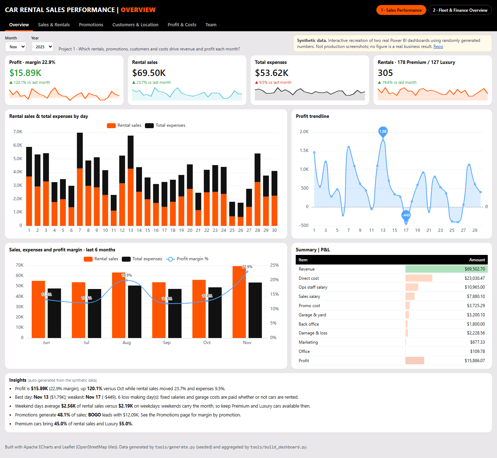
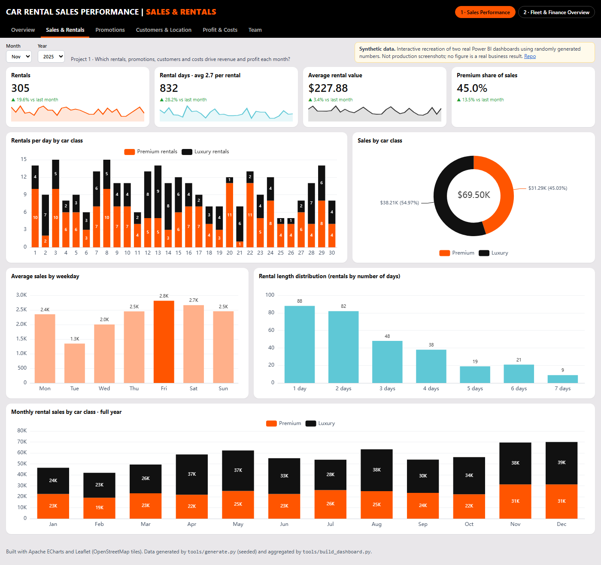
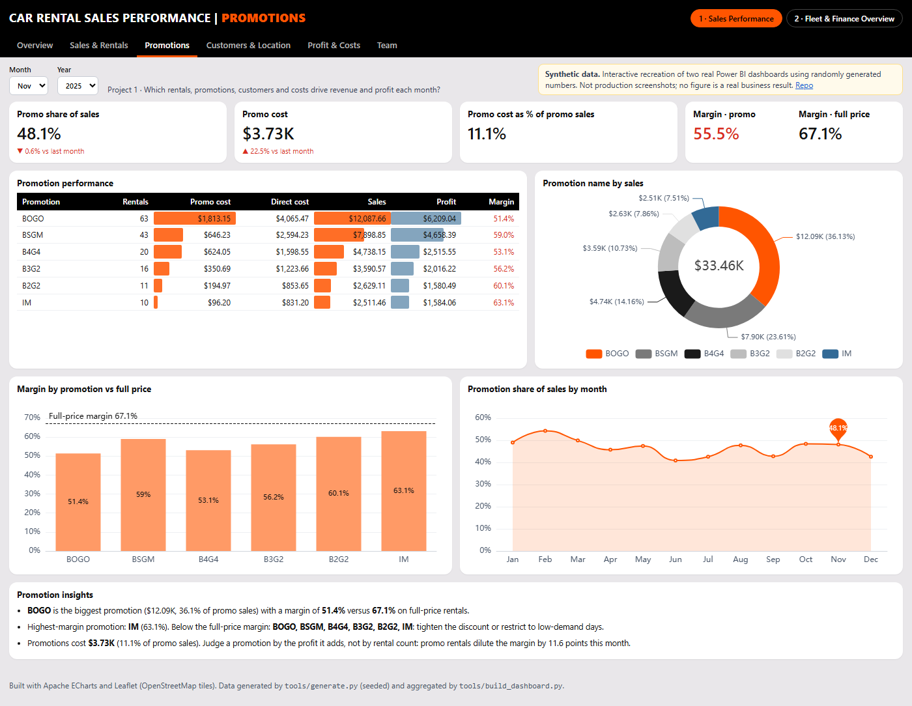
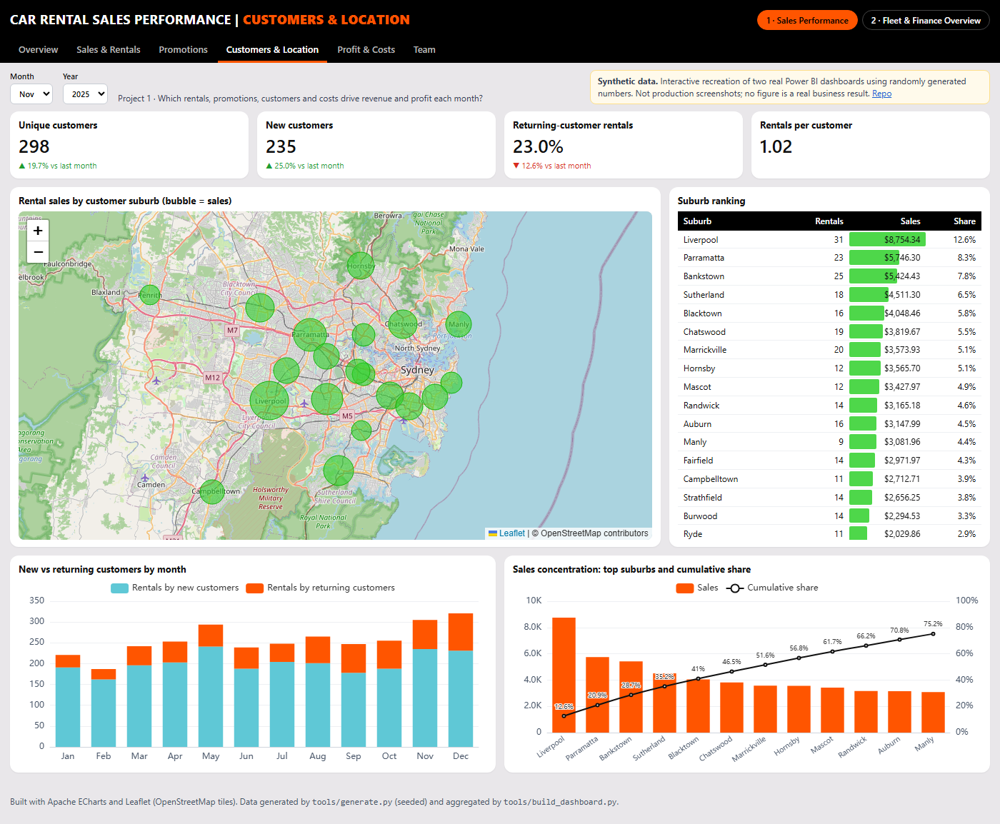
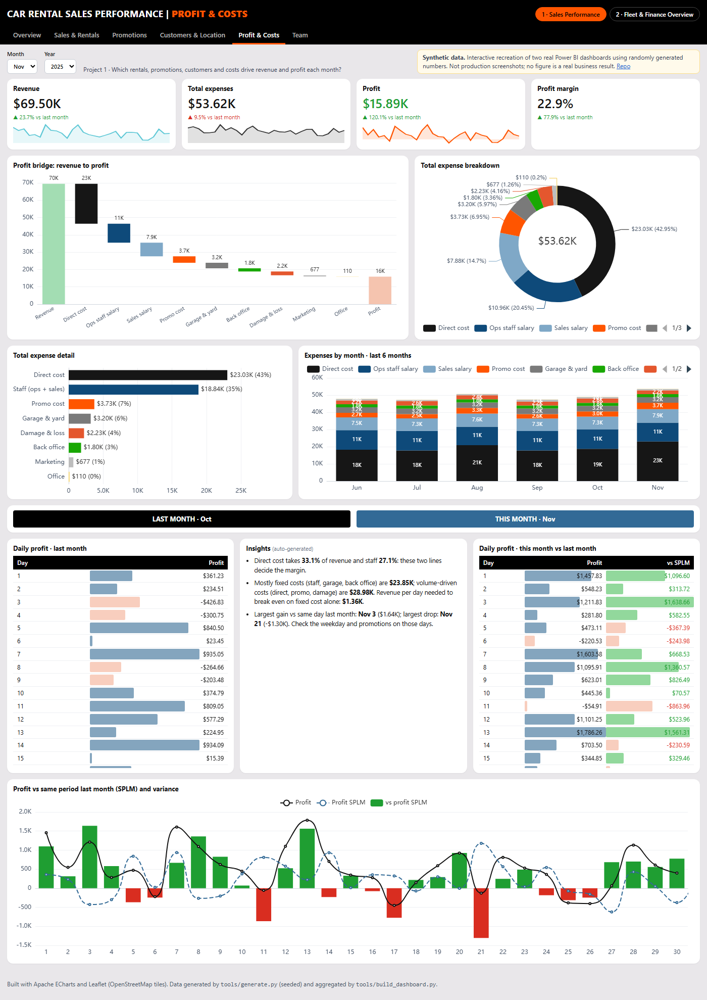
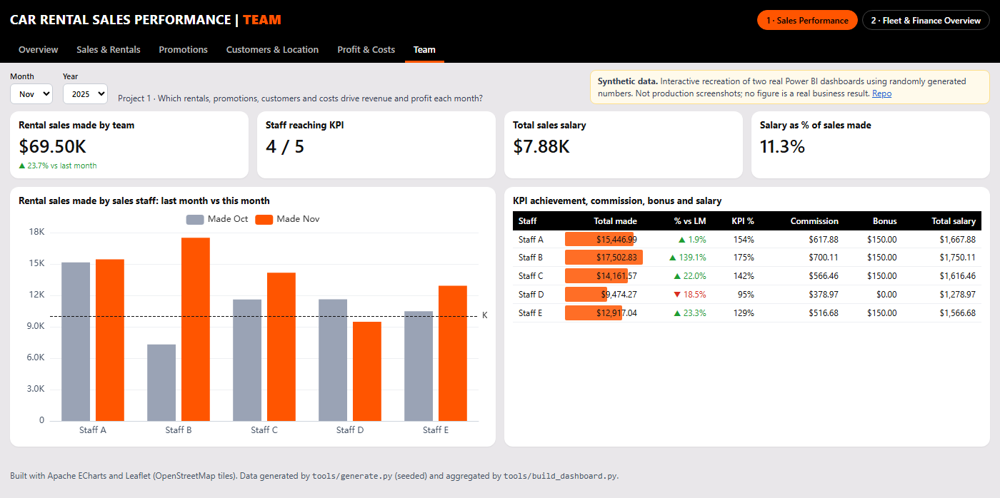

# Car Rental Sales Performance Dashboard — Power BI

**Tools:** Power BI (data modeling, DAX, Power Query), Excel · **Currency:** AUD · **Area:** Sydney, Australia
**Live interactive recreation:** [hongnganguyen.github.io/Hong-Nga-Portfolio](https://hongnganguyen.github.io/Hong-Nga-Portfolio/) (project **1 · Sales Performance**, 6 pages)

> ⚠️ **About the data.** The original dashboard was built for a real employer, so its data (customers, staff, suburbs, finances) is confidential and is not published. Everything in this folder is **synthetic**: randomly generated (fixed seed) with the same kind of tables, metrics and promotion codes as the real report. The images are screenshots of a web recreation of the dashboard built from that synthetic data, **not** screenshots of the production report, and no number is a real business result.

## Business question
> *Which rentals, promotions, customers and costs drive revenue and profit each month, and what should we do about it?*

The report serves three kinds of readers, so it is split into pages by purpose instead of one long canvas:

| Page | Reader / decision | What it shows |
|---|---|---|
| **1 · Overview** | Owner · "How is the month going?" | KPI cards with sparklines and MoM change (profit and margin, rental sales, expenses, rentals) · rental sales vs expenses by day · profit trendline · last 6 months with margin · P&L summary · auto-written insights |
| **2 · Sales & Rentals** | Sales manager · "What is being rented, when, for how long?" | Rentals, rental days, average rental value, Premium share · rentals per day by car class · sales by class · average sales by weekday · rental length distribution · monthly sales by class |
| **3 · Promotions** | Marketing · "Do promotions earn their cost?" | Promo share of sales, promo cost, margin on promotional vs full-price rentals · table per promotion (BOGO, BSGM, B4G4, B3G2, B2G2, IM) with margin · margin by promotion vs full-price baseline · promo share trend · insights |
| **4 · Customers & Location** | Sales / operations · "Who rents and where from?" | Unique, new and returning customers, rentals per customer · bubble map and ranking of customer suburbs · new vs returning by month · sales concentration (Pareto) |
| **5 · Profit & Costs** | Owner / finance · "Where does the money go?" | Profit bridge (revenue → profit waterfall) · expense donut and detail · expenses by month · last month vs this month daily profit with variance vs same period last month (SPLM) · insights |
| **6 · Team** | Manager · "Is the sales team on target?" | Total made per staff vs previous month, KPI achievement, commission, bonus and salary |

**Design choices (BI best practice):** executive summary first, then drill-down pages; the same Month slicer and previous-month comparison on every page; KPI cards that show value, trend and change together; one accent color with consistent meaning (green good / red bad); charts chosen for the question (waterfall for a P&L bridge, Pareto for concentration, distribution for rental length); every analysis page ends with a plain-language insight instead of leaving interpretation to the reader.

## Data model (star schema)
`rentals` (fact: date, suburb, customer, new-customer flag, car class, rental days, amount, promotion, promo cost, direct cost, sales staff) · `expenses` (daily fact by cost category) · `staff_kpi` · `promotions` · `suburbs` · `calendar`
CSV files in [`data/`](data) (≈3,100 synthetic rentals in 2025, ≈2,400 customers, 20 suburbs, 5 sales staff).

Measures in the model (names): Total Sales, Total Expenses, Profit, % Profit Margin, MoM / SPLM variants, Rentals, Rental Days, Average Rental Value, Total Premium / Luxury, Promo Cost, Promo Share, New / Returning Customers, Total Made, KPI %, Bonus, Total Salary.

## Preview (synthetic data)

## Sample report
[`reports/sample-report-2025-11.md`](reports/sample-report-2025-11.md): example of the monthly report that sits on top of the dashboard (KPIs vs previous month, expense structure, promotion performance, highlights, recommended actions), computed from the synthetic data.

## How to reproduce
Run `python tools/generate.py` and `python tools/build_dashboard.py` from the repo root. To rebuild it in Power BI Desktop, load the CSVs (Get Data → Text/CSV), relate `rentals[date]` and `expenses[date]` to `calendar[date]`, `rentals[suburb]` to `suburbs`, `rentals[sales_staff]` to `staff_kpi[staff]`, `rentals[promotion_name]` to `promotions`, then build the measures above and one report page per row of the table.
