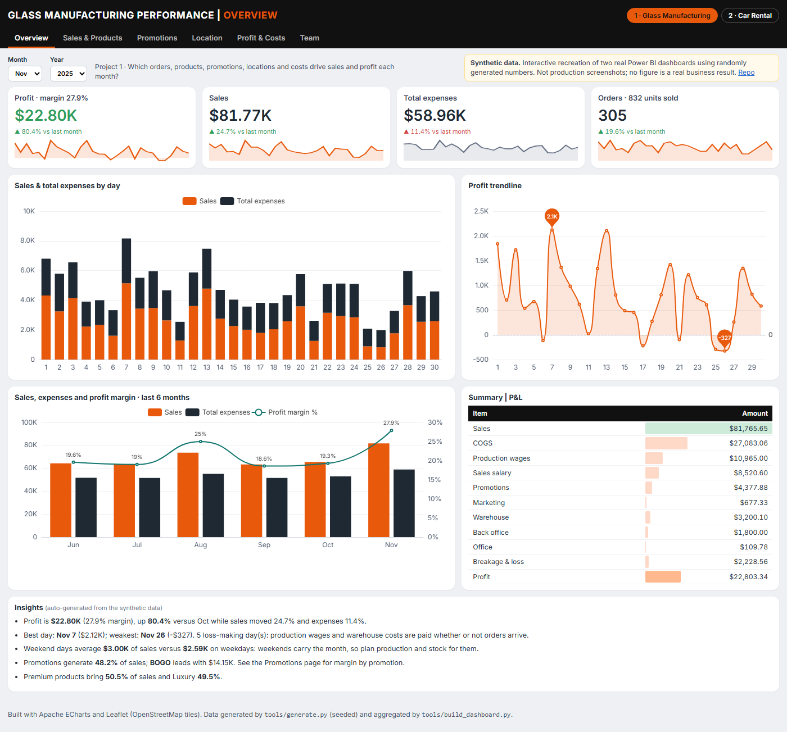
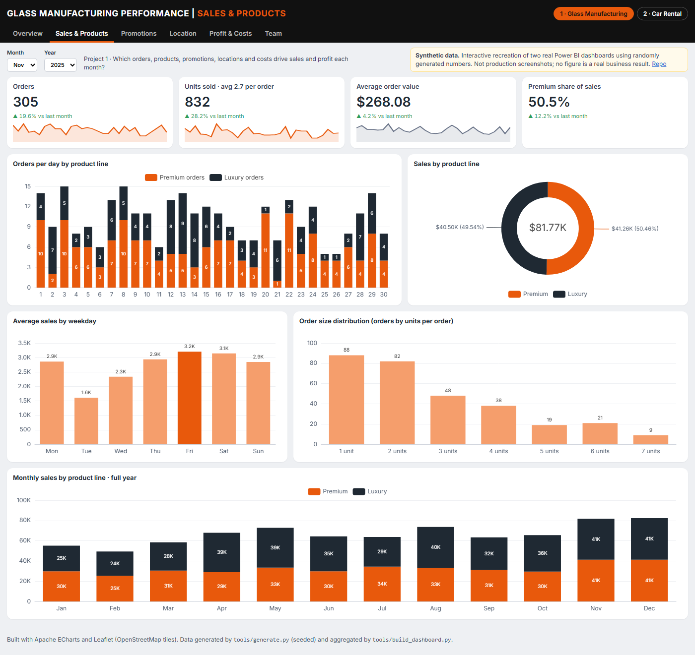
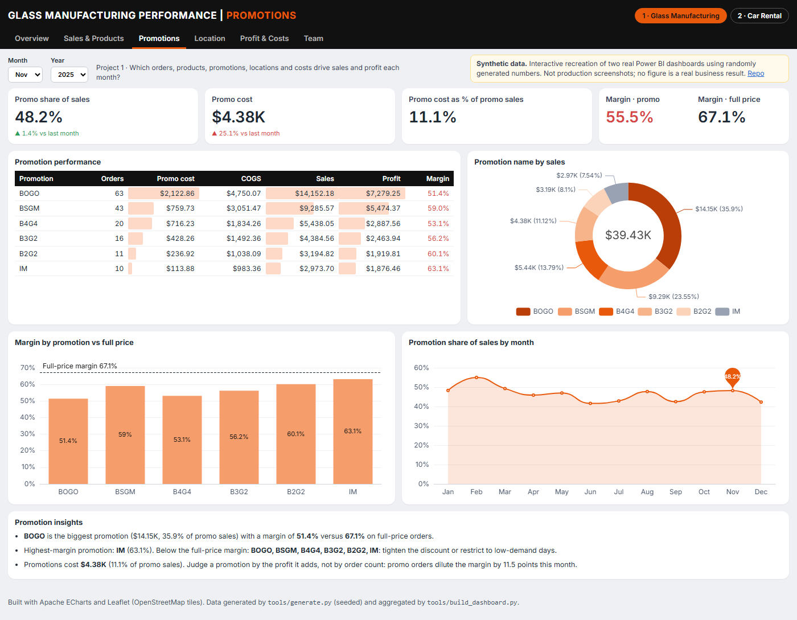
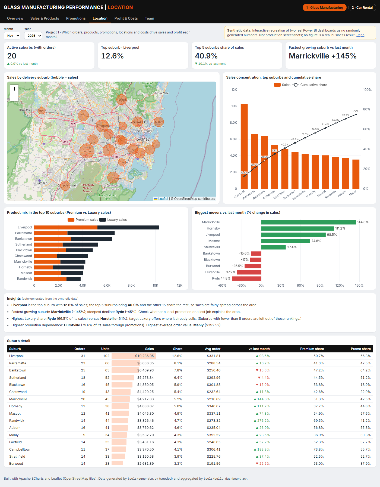
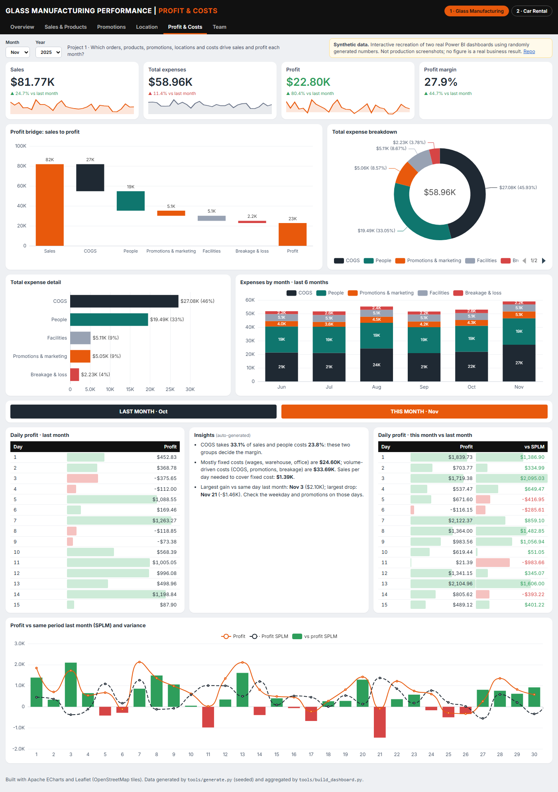
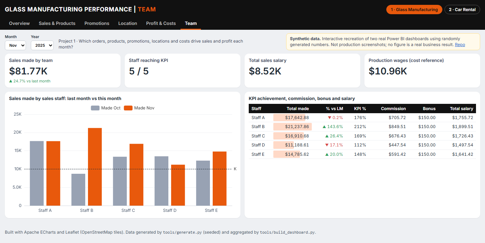

# Glass Manufacturing Performance Dashboard — Power BI

**Industry:** manufacturing (glass products, Premium and Luxury lines) · **Tools:** Power BI (data modeling, DAX, Power Query), Excel · **Currency:** AUD · **Area:** Sydney, Australia

> ⚠️ **About the data.** The original dashboard was built for a real employer, so its data (orders, staff, delivery addresses, finances) is confidential and is not published. Everything in this folder is **synthetic**: randomly generated (fixed seed) with the same kind of tables, metrics and promotion codes as the real report. The images are screenshots of a web recreation of the dashboard built from that synthetic data, **not** screenshots of the production report, and no number is a real business result.

## Business question
> *Which orders, products, promotions, locations and costs drive sales and profit each month, and what should we do about it?*

The report serves different readers, so it is split into pages by purpose instead of one long canvas:

| Page | Reader / decision | What it shows |
|---|---|---|
| **1 · Overview** | Owner · "How is the month going?" | KPI cards with sparklines and MoM change (profit and margin, sales, expenses, orders) · sales vs expenses by day · profit trendline · last 6 months with margin · P&L summary · auto-written insights |
| **2 · Sales & Products** | Sales manager · "What sells, when, in what size?" | Orders, units sold, average order value, Premium share · orders per day by product line · sales by line · average sales by weekday · order size distribution · monthly sales by line |
| **3 · Promotions** | Marketing · "Do promotions earn their cost?" | Promo share of sales, promo cost, margin on promotional vs full-price orders · table per promotion (BOGO, BSGM, B4G4, B3G2, B2G2, IM) with margin · margin by promotion vs full-price baseline · promo share trend · insights |
| **4 · Location** | Sales / operations · "Where do the orders go?" | Active suburbs, top suburb, top-5 share and fastest-growing suburb · bubble map of sales by delivery suburb · sales concentration (Pareto) · Premium vs Luxury mix in the top suburbs · biggest movers vs last month · suburb detail table (orders, units, sales, share, average order, change vs last month, Premium share, promo share) · insights |
| **5 · Profit & Costs** | Owner / finance · "Where does the money go?" | Profit bridge (sales → profit waterfall) · expense donut and detail · expenses by month · last month vs this month daily profit with variance vs same period last month (SPLM) · insights |
| **6 · Team** | Manager · "Is the sales team on target?" | Sales made per staff vs previous month, KPI achievement, commission, bonus and salary, with production wages shown as a cost reference |

## Design system (why the colors are limited)
- **One accent color** (orange) for the key measure on every chart; everything secondary is **neutral grey / ink**.
- **Green and red mean good and bad only**: variances, profit sign, KPI arrows. They are never used as decoration.
- **Nine expense lines are grouped into five fixed colors** (COGS, People, Promotions & marketing, Facilities, Breakage & loss), the same on every expense chart, so a color always means the same thing and charts never become a rainbow.
- Two-series comparisons always use the same pair (accent vs ink; this month vs last month); promotions use tints of the accent.
- Layout: executive summary first, then drill-down pages; the same Month slicer and previous-month comparison on every page; KPI cards that show value, trend and change together; charts chosen for the question (waterfall for a P&L bridge, Pareto for concentration, distribution for order size); every analysis page ends with plain-language insights.

## Data model (star schema)
`orders` (fact: date, delivery suburb, product line, quantity, amount, promotion, promo cost, COGS, sales staff) · `expenses` (daily fact by cost line) · `staff_kpi` · `promotions` · `suburbs` · `calendar`
CSV files in [`data/`](data) (≈3,100 synthetic orders in 2025, 20 suburbs, 5 sales staff).

> **No customer id or name.** Like the real data, the orders have only a delivery address, so the report analyses *locations* (not individual customers): reach, concentration, growth, mix and promotion dependence by suburb. Suburbs with fewer than 8 orders are left out of the ranked insights because small samples are noise.

Measures in the model (names): Total Sales, Total Expenses, Profit, % Profit Margin, MoM / SPLM variants, Orders, Units Sold, Average Order Value, Total Premium / Luxury, COGS, Promo Cost, Promo Share, Active Suburbs, Suburb Share, Top 5 Suburbs Share, Total Made, KPI %, Bonus, Total Salary.

## Preview (synthetic data)

## Sample report
[`reports/sample-report-2025-11.md`](reports/sample-report-2025-11.md): example of the monthly report that sits on top of the dashboard (KPIs vs previous month, expense structure, promotion performance, highlights, recommended actions), computed from the synthetic data.

## How to reproduce
Run `python tools/generate.py` and `python tools/build_dashboard.py` from the repo root. To rebuild it in Power BI Desktop, load the CSVs (Get Data → Text/CSV), relate `orders[date]` and `expenses[date]` to `calendar[date]`, `orders[suburb]` to `suburbs`, `orders[sales_staff]` to `staff_kpi[staff]`, `orders[promotion_name]` to `promotions`, then build the measures above and one report page per row of the table.
