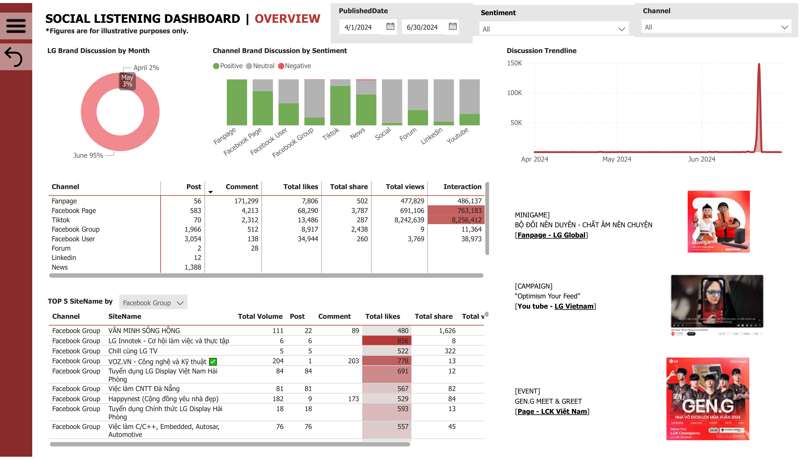
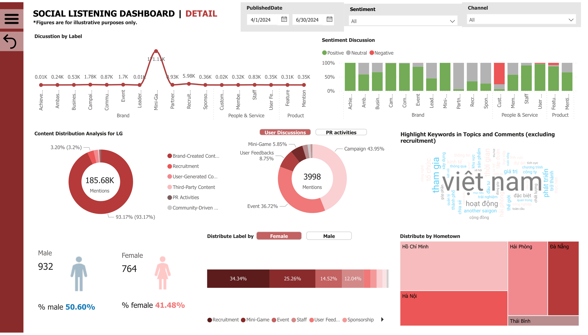
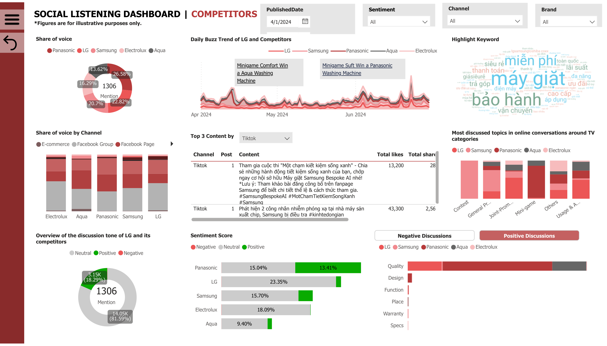

# LG Social Listening Report (Q2) — Power BI

**Tools:** Power BI (data modeling, DAX, visualization)
**Files:** [PDF report](report/Report-Social-Listening.pdf) · [Data dictionary](docs/data-dictionary.txt)

## Business context
A quarterly social-listening dashboard analysing online discussions about LG and its competitors in the washing-machine category: volume, sentiment, content type, audience and brand comparison.

## Data
Three datasets: **LG Corp Data** (posts/comments with sentiment, channel, labels, engagement), **Washing Machine Category Data** (same structure plus `Brand`), and **Demographic** (gender, relationship, hometown). See the [data dictionary](docs/data-dictionary.txt).

## Dashboard pages
1. **Overview** — total discussions, sentiment, trend over time, interactions by channel, most engaging sites.
2. **Detail analysis** — sentiment, content and demographic breakdown.
3. **Competitors** — LG vs. Panasonic, Samsung, Electrolux.

## Key insights
- Most sentiment toward LG is **neutral**; **customer service** receives the most negative feedback.
- Most LG discussion comes from brand-generated content, then recruitment content; user-generated content centers on campaigns, events and product feedback. Facebook Pages are the most active platform.
- Male users show more interest in LG; both genders are interested in recruitment; most users are in Ho Chi Minh City.
- **Competitors:** Panasonic has the highest discussion volume (mostly Facebook groups) and strong positive sentiment driven by minigames and prizes; Samsung gained positive engagement through contests; Electrolux got little attention with mostly neutral sentiment; LG leads on promotion, usage and attitude topics but also shows concerns, particularly about washing/rinsing specifications of front-loaders.
