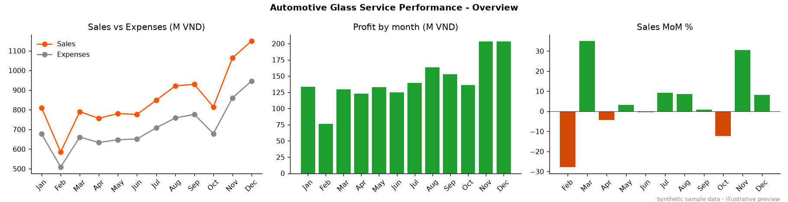
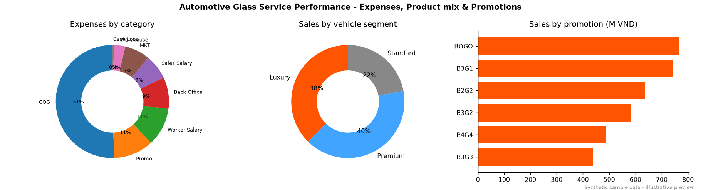
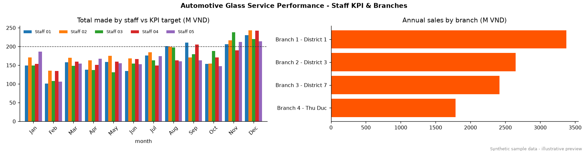

# Automotive Glass Service Performance Dashboard (Kiếng) — Power BI

**Tools:** Power BI (data modeling, DAX, Power Query), Excel
**Currency:** VND · **Period shown:** 2025 (synthetic)

> ⚠️ **About the data.** The original dashboard was built for a real employer, so its data is confidential and is not published. All data in this folder is **synthetic**, randomly generated with the same table structure and the same kind of metrics as the real model. Charts below are *illustrative previews* made from that synthetic data; they are not screenshots of the production report and the numbers are not real business results.

## Business problem
Management needed one place to monitor daily and monthly performance of a multi-location automotive glass (windshield and car window) sales and installation business: sales, every expense line, profit, promotion effectiveness and the sales team's KPIs, with month-over-month (MoM) comparison.

## Dashboard structure (3 pages)
| Page | What it shows |
|---|---|
| **Overview** | Total sales, total expenses, profit and % profit margin vs. same period last month (SPLM); sales by vehicle segment (Luxury / Premium / Standard); sales & expenses, profit and quantity trendlines; expenses breakdown (COG, Back Office, MKT, Warehouse, Cash Loss, Promo, Sales/Worker salary); sales by promotion (BOGO, B2G2, B3G1, B3G2, B3G3, B4G4…) |
| **Worker** | Per-employee (sales and installation staff) total made vs. previous month, KPI achievement, bonus and total salary, with month/year slicers |
| **Location** | Map of sales by branch address with expense breakdown per location |

Features: calendar table with date hierarchy, page-navigation buttons, month/year slicers, conditional formatting (up/down arrows, colour scales), tooltips.

## Data model (star schema)
`daily_revenue` (fact) · `expenses` (fact) · `staff_kpi` · `stores` · `promotions` · `calendar`
CSV files in [`data/`](data) (≈9,000 synthetic orders, 4 branches, 5 staff).

Measures in the model (names): Total Sales, Sales Same Day Last Month, Total Expenses, COG / MKT / Back-office / Warehouse / Promo expenses, Cash Loss, Profit, % Profit Margin, vs-profit-SPLM, Total Luxury / Premium (+SPLM), Total Made, KPIs, Bonus, Total Salary.

## Preview (synthetic data)

## Sample report
[`reports/sample-annual-report-2025.md`](reports/sample-annual-report-2025.md) — an example of the periodic report that sits on top of the dashboard (KPIs, highlights, recommended actions), computed from the synthetic data.

## How to reproduce
Load the CSVs into Power BI Desktop (Get Data → Text/CSV), relate `daily_revenue[date]` and `expenses[month]` to `calendar`, `store_id` to `stores`, then build the measures above. The generator script is in [`/tools/generate.py`](../../tools/generate.py).

